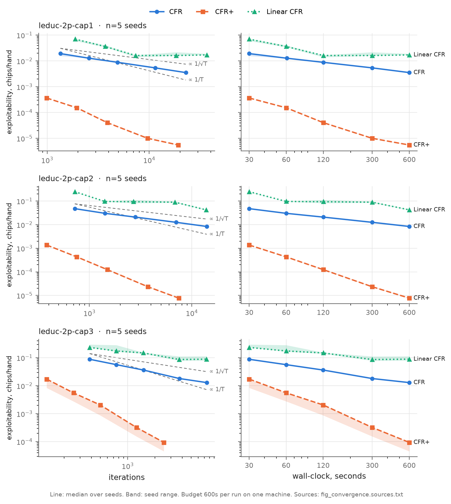
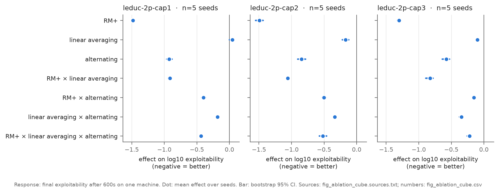
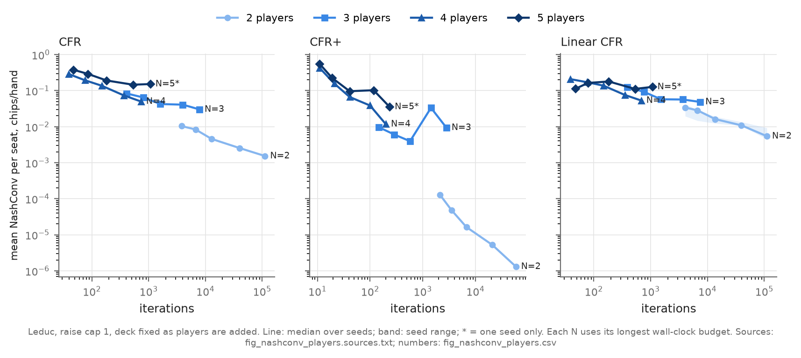
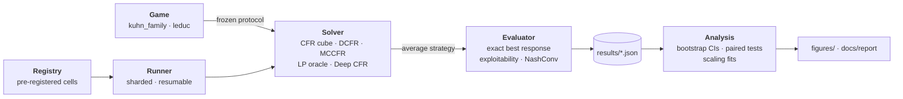

<div align="center">

# pokercfr

**Which property of a poker game makes CFR expensive?**
A controlled scaling study of the CFR algorithm family, on games small enough to solve *exactly*.


[Results](#results-at-a-glance) · [Try it](#try-it-in-60-seconds) · [How it fits together](#how-it-fits-together) · [Games](#the-games) · [Solvers](#the-solvers) · [Reproduce](#reproduce-and-run-experiments) · [FAQ](#faq)

</div>

---

## What this is

CFR (Counterfactual Regret Minimization) is the engine behind every strong computer poker agent, from
Libratus to Pluribus. A lot is known about how fast CFR variants converge on *one* game. Much less is known
about **which property of a game drives the cost**: the number of information sets, the number of deals,
the number of players, or the raise cap. Published comparisons usually change several of these at once, so
"CFR+ is faster" cannot be pinned on any one of them.

This repo changes **one property at a time**:

- a **ladder of poker games**: a Kuhn family with configurable deck, cards dealt and player count, plus
  Leduc Hold'em with a configurable raise cap and N players on a *fixed* deck;
- **one solver with an eight-corner ablation cube** (regret matching vs. matching+, uniform vs. linear
  averaging, simultaneous vs. alternating updates), plus DCFR, three flavours of MCCFR and an exact LP oracle;
- an **exact best-response evaluator**, so every reported number is a true exploitability or NashConv and
  never a sampled estimate, cross-checked against [OpenSpiel](https://github.com/google-deepmind/open_spiel);
- a **pre-registered design**: hypotheses, budgets, seeds and decision rules were committed *before* the
  final sweeps ran.

It is a course project (research track), written by eight people, and every number in the report traces to
a committed script and a JSON file in [`results/`](results/).

## Results at a glance

Three hypotheses were registered up front ([`docs/report/preregistration.md`](docs/report/preregistration.md)).

| | Claim | Where it stands |
|---|---|---|
| **H1** | At equal wall-clock budget, CFR+ reaches lower exploitability than vanilla CFR on 2-player Leduc, at **every** raise cap. | **Supported at all three caps**, 5 of 5 paired seeds each (table below). |
| **H2** | Cost to reach a fixed epsilon grows polynomially in information-set count, with a smaller exponent for CFR+. | Fit in [`fig_scaling_exponents`](figures/fig_scaling_exponents.png); the verdict and its (wide) confidence interval are in the report. |
| **H3** | With the deck **held fixed**, per-seat NashConv at a fixed budget rises with player count. | Data below. The registered rule is strict, so read the report for the verdict. |

**H1, in numbers** (2-player Leduc, 600 s per run on one machine, exploitability in chips/hand, mean of 5 seeds;
from [`results/verify/h1_verdict.log`](results/verify/h1_verdict.log)):

| Raise cap | Vanilla CFR | CFR+ | CFR+ is better by | Paired seeds won |
|:---:|---:|---:|---:|:---:|
| 1 | 3.53e-3 | 5.54e-6 | **638x** | 5/5 |
| 2 | 8.28e-3 | 7.77e-6 | **1,065x** | 5/5 |
| 3 | 1.30e-2 | 8.57e-5 | **151x** | 5/5 |

<details>
<summary><b>Figure: convergence of CFR, CFR+ and linear CFR at each raise cap</b> (click to expand)</summary>



Left: against iterations. Right: against wall-clock seconds. Line is the median over seeds, band is the seed
range. CFR+ is the bottom curve in every panel. Numbers: [`fig_convergence.sources.txt`](figures/fig_convergence.sources.txt).

</details>

<details>
<summary><b>Figure: which ingredient of CFR+ does the work?</b> (the ablation cube)</summary>



Each dot is the mean effect on log10 exploitability of switching an ingredient on (negative = better), with a
bootstrap 95% CI. Regret-matching+ is the biggest single lever at every cap; alternating updates is second.
This view is **exploratory** (no prediction was registered for it).

</details>

<details>
<summary><b>H3 data: more players, same 6-card deck</b> (Leduc, raise cap 1)</summary>



Final per-seat **mean** NashConv at each player count's full wall-clock budget (1 h; 6 h for 5 players, one
seed, shown partial). Mean, never the total, because the total grows with N simply from having more seats.

| Players | 2 | 3 | 4 | 5 (partial) |
|---|---:|---:|---:|---:|
| CFR | 1.53e-3 | 3.02e-2 | 5.00e-2 | 1.52e-1 |
| **CFR+** | **1.30e-6** | **9.36e-3** | **1.17e-2** | **3.54e-2** |
| Linear CFR | 6.39e-3 | 5.03e-2 | 5.33e-2 | 1.27e-1 |
| CFR+ iterations reached | 59,067 | 2,828 | 200 | 235 |

Two things to read carefully. First, a larger game gets far fewer iterations in the same wall-clock budget, so
this is a comparison at equal *time*, not equal iterations. Second, the pre-registered H3 rule also requires
the per-seat mean to stay above the multiplayer epsilon of 5e-2 at the largest N; CFR+ gets below that at N = 3
and 4. The official verdict is computed in [`docs/report/04_results.md`](docs/report/04_results.md), not here.

A fixed-deck check at matched iteration count ([`results/verify/fixed_deck_h3.json`](results/verify/fixed_deck_h3.json))
shows the same direction: at T = 8, mean NashConv is 0.265, 0.439, 0.623 and 0.846 for 2, 3, 4 and 5 players.
Six players is **infeasible** on this deck (6 private cards plus a public card do not fit in 6 cards), and
the code refuses to resize the deck silently.

</details>

## Try it in 60 seconds

```bash
git clone https://github.com/Samanyu-dev/pokercfr.git && cd pokercfr
./setup.sh                    # needs uv; builds .venv with Python 3.12 and installs everything
source .venv/bin/activate
pytest -q                     # the whole suite, including ground-truth validation
```

<details>
<summary><b>No uv? Plain venv instead</b></summary>

```bash
python3.12 -m venv .venv && source .venv/bin/activate
pip install -e ".[verify,dev]"          # add ",deep" for the optional Deep CFR baseline (PyTorch)
```

Python **3.12 only** (`requires-python = ">=3.12,<3.13"`): PyTorch and OpenSpiel have no wheels for newer versions.

</details>

**1. Solve Leduc Hold'em and measure how close you are** (about 20-40 s):

```python
from pokercfr.games import leduc
from pokercfr.solvers.cfr import CFRSolver, CFR_PLUS
from pokercfr.eval.exploitability import exploitability

game = leduc.game(players=2, raise_cap=2)        # standard Leduc
print(game)                                      # LeducGame('leduc-2p-cap2', info_sets=936)

solver = CFRSolver(game, CFR_PLUS)
solver.train(200)
print(exploitability(game, solver.average_strategy()))     # 0.00498 chips/hand
```

<details>
<summary><b>2. Race vanilla CFR against CFR+</b> (the H1 experiment in miniature)</summary>

```python
from pokercfr.games import leduc
from pokercfr.solvers.cfr import CFRSolver, VANILLA_CFR, CFR_PLUS
from pokercfr.eval.exploitability import exploitability

game = leduc.game()
for name, cfg in (("CFR ", VANILLA_CFR), ("CFR+", CFR_PLUS)):
    s = CFRSolver(game, cfg); s.train(200)
    print(name, f"{exploitability(game, s.average_strategy()):.5f}")
# CFR  0.09797
# CFR+ 0.00498        <- about 20x closer to equilibrium after the same 200 iterations
```

Any of the eight cube corners is available by name: `from pokercfr.solvers.cfr import ablation_cube`,
then `ablation_cube()["rm+/linear/sim"]`.

</details>

<details>
<summary><b>3. Walk a game tree by hand</b> (the frozen <code>Game</code> protocol)</summary>

```python
from pokercfr.games.kuhn_family import game

g = game("kuhn")
root = g.new_initial_state()
root.is_chance_node()                       # True: the deal is a chance node
state, prob = root.chance_outcomes()[0]     # one deal, probability 1/6
for action in ("p", "b", "b"):              # check, bet, call
    print(state.information_set_key(state.current_player()), state.legal_actions(), "->", action)
    state = state.apply_action(action)
# J ['p', 'b'] -> p
# Qp ['p', 'b'] -> b
# Jpb ['p', 'b'] -> b
state.is_terminal(), state.utilities()      # (True, [-2, 2.0])  Jack called and lost to the Queen
```

Actions: `p` is check or fold, `b` is bet or call. An information-set key is *your card + the public
history*, which is exactly what a CFR loop indexes regrets by.

</details>

<details>
<summary><b>4. Three players, deck still 6 cards</b> (per-seat NashConv)</summary>

```python
from pokercfr.games import leduc
from pokercfr.solvers.cfr import CFRSolver, CFR_PLUS
from pokercfr.eval.exploitability import evaluate

g3 = leduc.game(players=3, raise_cap=1)
s3 = CFRSolver(g3, CFR_PLUS); s3.train(20)
r = evaluate(g3, s3.average_strategy())
print(r.gains, r.mean)       # each seat's gain from deviating, and the per-seat mean
# leduc.game(players=6) raises ValueError: the fixed deck cannot deal 6 hands + a public card
```

`exploitability()` is a two-player concept and raises for N > 2; use `evaluate()` for NashConv.

</details>

### Pick your path

| I want to... | Go to |
|---|---|
| see a number I can trust | the snippets above, then `make verify` |
| understand the design and the hypotheses | [`docs/report/`](docs/report/) and [`preregistration.md`](docs/report/preregistration.md) |
| reproduce a figure or a table | [Reproduce](#reproduce-and-run-experiments) |
| add a new game | implement the `Game` / `GameState` protocol in [`core/protocols.py`](pokercfr/core/protocols.py); [`games/leduc.py`](pokercfr/games/leduc.py) is a worked example with a mid-tree chance node |
| add a new solver | implement the `Solver` protocol; the runner and evaluator need nothing else |
| contribute | [`CONTRIBUTING.md`](CONTRIBUTING.md) |

## How it fits together



Everything codes against one small contract, [`core/protocols.py`](pokercfr/core/protocols.py): a `Game`
produces immutable `GameState`s, each of which is exactly one of *chance*, *decision* or *terminal*. Chance is a
real node type, which is what lets Leduc deal its public card in the middle of the tree. Because the contract
is frozen, a new game works with every solver and the evaluator without touching either.

Three design rules run through the code:

1. **Exact, not sampled.** Exploitability comes from a full best-response computation over the tree.
2. **Identity by content hash.** A run is a `RunSpec`; its result file is named by the hash of its spec, so two
   machines can never collide and a rerun overwrites instead of duplicating.
3. **Resumable.** Solver state is checkpointed at every measurement, so a closed lid costs minutes, not hours.

## The games

A "rung" is a config, not a new codebase. Sizes below are computed by the code, not typed in.

<details open>
<summary><b>Kuhn-family ladder</b> (one betting round, configurable deck, cards dealt and players)</summary>

| Rung | Players | Info sets | Deals |
|---|:---:|---:|---:|
| `kuhn` | 2 | 12 | 6 |
| `4rank` | 2 | 16 | 12 |
| `4rank-2dealt` | 2 | 24 | 6 |
| `4rank-2suit` | 2 | 32 | 56 |
| `4rank-2suit-2dealt` | 2 | 112 | 420 |
| `kuhn-3p` | 3 | 48 | 24 |
| `4rank-2suit-3p` | 3 | 96 | 336 |
| `4rank-2suit-2dealt-3p` | 3 | 336 | 2,520 |
| `4rank-2suit-4p` | 4 | 256 | 1,680 |
| `13rank-4suit-2dealt-2p` | 2 | 5,304 | 1,624,350 |
| `6rank-4suit-2dealt-4p` | 4 | 8,832 | 1,853,386,920 |

Cost is driven by the number of **deals**, not information sets: with one betting round the info-set count
stays tiny even with a full deck, while the deal count explodes along the player axis.

</details>

<details open>
<summary><b>Leduc Hold'em</b> (two rounds, a public card, configurable raise cap, N players on a fixed deck)</summary>

Standard Leduc: 6 cards (3 ranks x 2 suits), ante 1, bets of 2 then 4, a pair with the public card beats any
unpaired hand. Rung names are `leduc-<players>p-cap<cap>`.

| Players | Cap 1 | Cap 2 | Cap 3 |
|:---:|---:|---:|---:|
| 2 | 384 | **936** | 1,728 |
| 3 | 2,232 | 13,878 | 64,908 |
| 4 | 10,752 | 153,576 | 1,596,336 |
| 5 | 47,280 | 1,422,930 | 29,136,780 |
| 6 | infeasible | infeasible | infeasible |

*Info sets.* Standard 2-player cap 2 has 936, identical to OpenSpiel's `leduc_poker`.

**What is new here.** `raise_cap` is a free parameter (the opening bet counts toward it, per round), and the
**deck stays at 6 cards as players are added**. OpenSpiel instead grows the deck as `2(N+1)` with player
count, which confounds "more players" with "a different card distribution". Holding the deck fixed is what
lets H3 attribute a change to the number of players alone.

</details>

## The solvers

<details open>
<summary><b>CFR and its eight-corner ablation cube</b></summary>

One solver, three independent switches, 2 x 2 x 2 = 8 corners. Vanilla CFR is one corner and CFR+ is the
opposite one.

| Switch | Off | On |
|---|---|---|
| Regret update | regret matching | **regret matching+** (negative regrets clamped to zero) |
| Averaging | uniform | **linear** (later iterations weigh more) |
| Update order | simultaneous | **alternating** (one player per traversal) |

`cfr` = all off, `cfr+` = all on, `linear-cfr` = linear averaging only. The other five corners are named by
their switches, for example `rm+/uniform/sim`. The same machinery also runs **DCFR**
(Brown & Sandholm's discounting family, `dcfr-a1.5-b0-g2`).

Note that alternating updates cost two traversals per iteration, so CFR+ does about half as many iterations as
CFR in the same time; it wins anyway. That is why H1 is stated in **wall-clock** terms.

</details>

<details>
<summary><b>The other solvers</b></summary>

| Solver | File | What it is for |
|---|---|---|
| MCCFR (outcome, external, chance sampling) | [`solvers/mccfr.py`](pokercfr/solvers/mccfr.py) | the sampled variants and their variance across seeds |
| Sequence-form LP oracle | [`solvers/lp_oracle.py`](pokercfr/solvers/lp_oracle.py) | an exact Nash value to compare CFR against, independent of CFR |
| Vectorized traversal | [`solvers/vectorized.py`](pokercfr/solvers/vectorized.py) | numpy traversal for the larger decks |
| Deep CFR | [`solvers/deep_cfr.py`](pokercfr/solvers/deep_cfr.py) | optional baseline: does approximation cost anything on a solvable game? Needs `.[deep]` |

</details>

## How we know the numbers are right

An evaluator that is slightly wrong would quietly corrupt every result, so the instrument is tested harder
than the algorithms.

- **Best-response audit:** 46 of 46 checks pass; the largest disagreement with OpenSpiel is 4e-16
  ([`results/verify/br_audit.json`](results/verify/br_audit.json)).
- **Leduc cross-check:** the engine matches OpenSpiel's `leduc_poker` on information-set count (936) and on the
  exploitability of the uniform policy; our trained policies, scored by *their* evaluator, agree with ours to
  about 1e-15. CFR+ trajectories agree within the float-summation noise floor, which we measure by running our
  own solver with chance outcomes in reverse order ([`scripts/s5_openspiel_leduc_crosscheck.py`](scripts/s5_openspiel_leduc_crosscheck.py)).
- **Closed-form checks:** Kuhn against its known equilibrium, and an independent LP oracle.
- **Determinism and hashing:** spec hashes are stable across processes; seeds are independent where they should be.

```bash
make verify         # best-response audit + OpenSpiel cross-checks; exits non-zero on any disagreement
```

## Reproduce and run experiments

```bash
make test           # pytest
make verify         # the audits above
make results        # aggregate results/*.json into a table
make figures        # regenerate every figure from committed results
make report         # regenerate docs/report/numbers.md, every entry citing its source file
make all            # all of the above
```

<details>
<summary><b>Run a slice of the pre-registered sweep</b></summary>

The registry ([`experiments/registry.py`](pokercfr/experiments/registry.py)) holds every planned run: 753
distinct cells across the matrices. The runner shards them across machines, skips what is already done, and
resumes what was interrupted.

```bash
python -m pokercfr.experiments.runner --matrix leduc-sweep --dry-run     # list the cells, run nothing
python -m pokercfr.experiments.runner --matrix leduc-sweep --estimate    # measured CPU-hours first
python -m pokercfr.experiments.runner --matrix leduc-sweep --shard 0 --of 12 --jobs 8
```

| Flag | Meaning |
|---|---|
| `--shard K --of N` | this machine takes every cell where `index % N == K` (a list like `1,3,8` also works) |
| `--only timed` / `iteration` | only wall-clock-budgeted or only iteration-budgeted cells |
| `--games` | restrict to some rungs |
| `--order longest-first` | default; keeps all cores busy to the end of the shard |
| `--force` | redo cells that are already complete |

Runs write one JSON per cell into `results/`; commit it when a shard finishes. Wall-clock comparisons
(H1) must stay on **one** machine type, because a faster core does more iterations in the same time.

</details>

## Repository layout

```
pokercfr/
├── pokercfr/
│   ├── core/          protocols.py (the frozen contract) · config.py (RunSpec, hashing, seeding)
│   ├── games/         kuhn_family.py (the ladder) · leduc.py · kuhn_reference.py
│   ├── solvers/       cfr.py (ablation cube, DCFR) · mccfr.py · lp_oracle.py · vectorized.py · deep_cfr.py
│   ├── eval/          best_response.py · exploitability.py (NashConv, record schema) · tournament.py
│   ├── agents/        fixed-policy baseline opponents
│   ├── analysis/      bootstrap CIs · paired tests · scaling fits · plots
│   └── experiments/   registry.py (pre-registration) · runner.py (sharded, resumable)
├── scripts/           one script per experiment or check; each writes to results/verify/
├── results/           one JSON per run, committed; results/verify/ holds the audits
├── figures/           generated from results, each with a .sources.txt, never hand-made
├── docs/report/       the report, section by section, plus the pre-registration
├── tests/             unit tests and ground-truth validation (including OpenSpiel)
└── setup.sh · Makefile · pyproject.toml
```

## Documentation

| | |
|---|---|
| [`docs/report/`](docs/report/) | the report: introduction, background, method, results, discussion |
| [`docs/report/preregistration.md`](docs/report/preregistration.md) | hypotheses, decision rules, budgets, seeds, and the amendment log |
| [`LADDER.md`](LADDER.md) | the original game-ladder plan (its hypothesis numbering is superseded by the pre-registration) |
| [`EXPANSION.md`](EXPANSION.md) | the algorithm and condition-axis study |
| [`CONTRIBUTING.md`](CONTRIBUTING.md) | conventions, who owns which files, and how to work in parallel |

## Team and contributing

Eight people, one owner per file. The ownership table, the frozen-contract rule and the commit conventions are
in [`CONTRIBUTING.md`](CONTRIBUTING.md#team-and-ownership). The short version: conventional commits, many small
ones under your own name, `git pull --rebase` and `pytest -q` before you push to `main`.

## FAQ

<details>
<summary><b>Why not just sample, as most poker AI does?</b></summary>

Because sampling hides the very thing we want to measure. With exact best response, an exploitability number is
the true distance from equilibrium; with sampled estimates it carries noise that can be larger than the gaps
between algorithms. The price is that we can only study games small enough to enumerate, which is the point
of building a ladder of them.

</details>

<details>
<summary><b>Why does the deck stay at 6 cards as players are added?</b></summary>

So that player count is the only thing that changes. If the deck grows too, any change in difficulty could be
about the cards instead. The consequence is a hard limit: a 6-card deck cannot deal 6 hands plus a public card,
so 6-player Leduc is rejected with a clear error instead of being silently resized.

</details>

<details>
<summary><b>Why is H1 stated in wall-clock time and not iterations?</b></summary>

CFR+ updates one player per traversal, so each of its iterations costs more. Comparing at equal iterations would
flatter the alternating variants; equal wall-clock is the comparison a practitioner actually faces. For the same
reason all H1 runs stay on a single machine type.

</details>

<details>
<summary><b>What does "pre-registered" buy us?</b></summary>

The hypotheses, epsilon targets, budgets, seeds and decision rules were committed before the final sweeps ran,
and later changes are logged as amendments rather than edited in place. That is what separates an experiment
from "we tried things until a plot looked good". Where a rule is strict, the report says so, even when the
result is less flattering.

</details>

<details>
<summary><b>Do I need a GPU?</b></summary>

No. Everything is tabular CPU code. The long runs were done on laptops and Kaggle CPU sessions. PyTorch is
needed only for the optional Deep CFR baseline.

</details>

## References

- Zinkevich, Johanson, Bowling, Piccione. [Regret Minimization in Games with Incomplete Information](https://proceedings.neurips.cc/paper/2007/hash/08d98638c6fcd194a4b1e6992063e944-Abstract.html). NeurIPS 2007.
- Tammelin. [Solving Large Imperfect Information Games Using CFR+](https://arxiv.org/abs/1407.5042). 2014.
- Brown, Sandholm. [Solving Imperfect-Information Games via Discounted Regret Minimization](https://arxiv.org/abs/1809.04040). AAAI 2019.
- Brown, Lerer, Gross, Sandholm. [Deep Counterfactual Regret Minimization](https://arxiv.org/abs/1811.00164). ICML 2019.
- Brown, Sandholm. [Superhuman AI for multiplayer poker](https://www.science.org/doi/10.1126/science.aay2400). Science, 2019.
- Southey et al. *Bayes' Bluff: Opponent Modelling in Poker* (the origin of Leduc Hold'em). UAI 2005.
- Lanctot et al. [OpenSpiel: A Framework for Reinforcement Learning in Games](https://github.com/google-deepmind/open_spiel). 2019.
